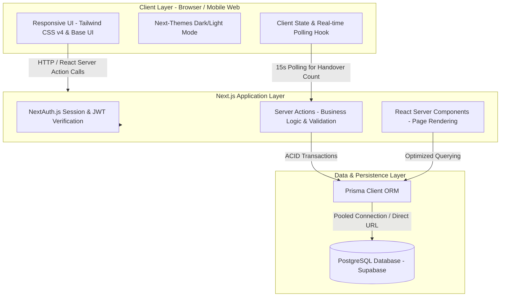
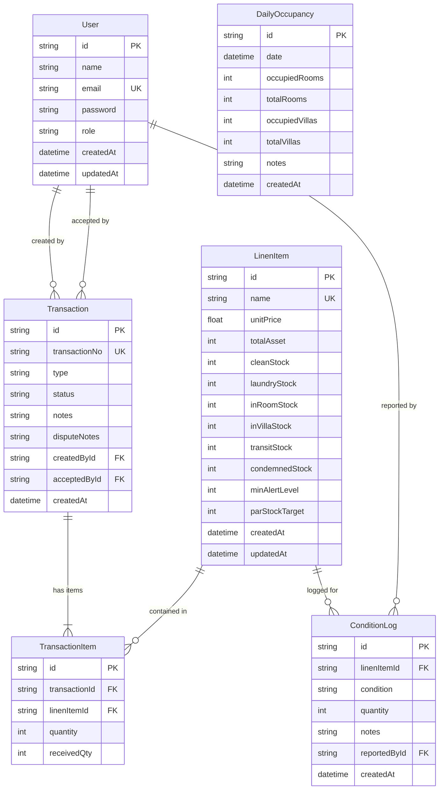
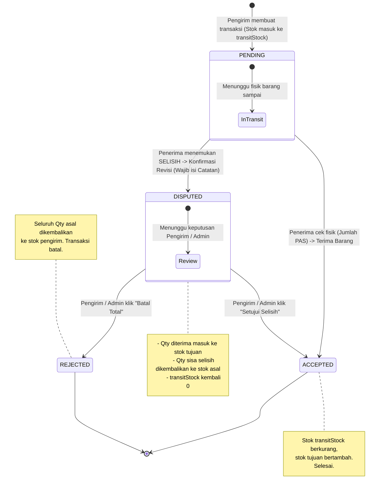

# Architecture Document
## Sistem Informasi Manajemen Alur Stok Linen Hotel
**Studi Kasus:** Hotel & Resort Green Star Park Simalungun  
**Teknologi:** Next.js 16 (App Router), TypeScript, Tailwind CSS v4, Prisma ORM, PostgreSQL (Supabase), NextAuth.js

---

## 1. High-Level Architecture

Sistem ini dibangun dengan arsitektur **Server-Driven Modern Web Application** menggunakan Next.js App Router (React Server Components & Server Actions) yang terhubung langsung ke basis data relasional PostgreSQL melalui Prisma ORM.



---

## 2. Technology Stack Breakdown

* **Full-stack Framework:** [Next.js 16](https://nextjs.org/) (App Router dengan React Server Components dan Server Actions).
* **Bahasa Pemrograman:** [TypeScript](https://www.typescriptlang.org/) dengan *strict type checking*.
* **UI & Component Layer:**
  * [React 19](https://react.dev/)
  * [Tailwind CSS v4](https://tailwindcss.com/)
  * [@base-ui/react](https://base-ui.com/) (Headless primitive components)
  * [Lucide React](https://lucide.dev/) (Ikonografi sistem)
  * [Sonner](https://sonner.emilkowal.ski/) (Toast pemberitahuan interaktif)
  * [next-themes](https://github.com/pacocoursey/next-themes) (Mode Terang/Gelap)
* **Database & ORM:**
  * [PostgreSQL](https://www.postgresql.org/) di-host pada [Supabase](https://supabase.com/) dengan dukungan *Connection Pooling* (`pgbouncer`).
  * [Prisma ORM 5](https://www.prisma.io/) untuk skema deklaratif, migrasi, dan *type-safe query builder*.
* **Autentikasi & Keamanan:**
  * [NextAuth.js 4](https://next-auth.js.org/) dengan *Credentials Provider*.
  * [bcryptjs](https://github.com/dcodeIO/bcrypt.js) untuk hashing kata sandi dengan salt cost 10.

---

## 3. Database Schema Design (Prisma)

Skema basis data dirancang untuk menjaga integritas data sirkulasi multi-unit (*hotel room* & *villa*), pencatatan status barang mengambang (*transit stock*), serta mekanisme penyelesaian sengketa (*dispute resolution*).

### Entity-Relationship Diagram (ERD)



### Definisi Skema Prisma (`schema.prisma`)

```prisma
datasource db {
  provider  = "postgresql"
  url       = env("DATABASE_URL")
  directUrl = env("DIRECT_URL")
}

generator client {
  provider = "prisma-client-js"
}

model User {
  id             String         @id @default(uuid())
  name           String
  email          String         @unique
  password       String
  role           String         // ADMIN_EXECUTIVE_HOUSEKEEPER, STAF_HOUSEKEEPING, STAF_LAUNDRY
  createdAt      DateTime       @default(now())
  updatedAt      DateTime       @updatedAt
  transactions   Transaction[]  @relation("CreatedTransactions")
  acceptedTrans  Transaction[]  @relation("AcceptedTransactions")
  conditionLogs  ConditionLog[]
}

model LinenItem {
  id              String         @id @default(uuid())
  name            String         @unique // Duvet Cover, Sheet, Pillow Case, dll.
  unitPrice       Float          // Harga satuan dalam Rupiah
  totalAsset      Int            // Total inventaris milik hotel
  cleanStock      Int            // Stok bersih di gudang housekeeping
  laundryStock    Int            // Stok sedang dicuci di laundry
  inRoomStock     Int            // Stok terpasang di kamar hotel
  inVillaStock    Int            @default(0) // Stok terpasang di unit villa
  transitStock    Int            @default(0) // Stok mengambang dalam perjalanan serah terima
  condemnedStock  Int            // Total linen rusak / afkir permanen
  minAlertLevel   Int            // Batas minimal peringatan stok kritis
  parStockTarget  Int            // Kuota ideal par stock hotel
  createdAt       DateTime       @default(now())
  updatedAt       DateTime       @updatedAt
  
  transactions    TransactionItem[]
  conditionLogs   ConditionLog[]
}

model Transaction {
  id            String            @id @default(uuid())
  transactionNo String            @unique
  type          String            // DIRTY_HOTEL_TO_LAUNDRY, DIRTY_VILLA_TO_LAUNDRY, LAUNDRY_TO_CLEAN, CLEAN_TO_HOTEL, CLEAN_TO_VILLA
  status        String            @default("PENDING") // PENDING, DISPUTED, ACCEPTED, REJECTED
  notes         String?
  disputeNotes  String?
  createdById   String
  createdBy     User              @relation("CreatedTransactions", fields: [createdById], references: [id])
  acceptedById  String?
  acceptedBy    User?             @relation("AcceptedTransactions", fields: [acceptedById], references: [id])
  createdAt     DateTime          @default(now())
  
  items         TransactionItem[]
}

model TransactionItem {
  id            String      @id @default(uuid())
  transactionId String
  transaction   Transaction @relation(fields: [transactionId], references: [id], onDelete: Cascade)
  linenItemId   String
  linenItem     LinenItem   @relation(fields: [linenItemId], references: [id])
  quantity      Int         // Jumlah yang dikirim oleh pembuat transaksi
  receivedQty   Int?        // Jumlah riil yang dihitung dan diterima oleh penerima
}

model ConditionLog {
  id            String         @id @default(uuid())
  linenItemId   String
  linenItem     LinenItem      @relation(fields: [linenItemId], references: [id])
  condition     String         // GOOD, STAINED, DAMAGED
  quantity      Int
  notes         String?
  reportedById  String
  reportedBy    User           @relation(fields: [reportedById], references: [id])
  createdAt     DateTime       @default(now())
}

model DailyOccupancy {
  id             String   @id @default(uuid())
  date           DateTime @default(now())
  occupiedRooms  Int
  totalRooms     Int      @default(100)
  occupiedVillas Int      @default(0)
  totalVillas    Int      @default(20)
  notes          String?
  createdAt      DateTime @default(now())
}
```

---

## 4. Business Logic Flow & State Mutations

### 4.1. Siklus Sirkulasi & Serah Terima (Handover State Machine)

Setiap perpindahan linen antar-divisi menggunakan mekanisme verifikasi dua arah (*two-way handshake*) untuk memastikan tidak ada barang hilang tanpa pertanggungjawaban:



### 4.2. Aturan Mutasi Stok per Jenis Transaksi

Semua mutasi stok dijalankan di dalam blok transaksi atomik (`prisma.$transaction`) dengan pengecekan kecukupan stok secara paralel (`Promise.all`):

| Jenis Transaksi (`type`) | Aksi Awal (Saat Submit) | Aksi Akhir (Saat `ACCEPTED`) | Catatan Khusus |
|---|---|---|---|
| `DIRTY_HOTEL_TO_LAUNDRY` | `inRoomStock` $\downarrow$, `transitStock` $\uparrow$ | `transitStock` $\downarrow$, `laundryStock` $\uparrow$ | Linen kotor dari kamar hotel |
| `DIRTY_VILLA_TO_LAUNDRY` | `inVillaStock` $\downarrow$, `transitStock` $\uparrow$ | `transitStock` $\downarrow$, `laundryStock` $\uparrow$ | Linen kotor dari unit villa |
| `LAUNDRY_TO_CLEAN` | `laundryStock` $\downarrow$, `transitStock` $\uparrow$ | `transitStock` $\downarrow$, `cleanStock` $\uparrow$ | Linen bersih siap pakai ke gudang |
| `CLEAN_TO_HOTEL` | `cleanStock` $\downarrow$, `inRoomStock` $\uparrow$ | Langsung `ACCEPTED` | Sirkulasi internal housekeeping |
| `CLEAN_TO_VILLA` | `cleanStock` $\downarrow$, `inVillaStock` $\uparrow$ | Langsung `ACCEPTED` | Sirkulasi internal housekeeping |

### 4.3. Pencatatan Kondisi & Otomasi Pemotongan Afkir (`DAMAGED`)
* **`GOOD`**: Tidak mengubah posisi stok fisik (pencatatan berkala).
* **`STAINED`**: Menandai barang bernoda yang perlu diproses cuci ulang (*rewash*), barang tetap berada di `laundryStock`.
* **`DAMAGED` (Afkir Permanen)**:
  * Sistem memvalidasi ketersediaan `cleanStock` $\ge$ `quantity`.
  * Secara atomik menjalankan mutasi:
    $$\Delta \text{totalAsset} = - \text{quantity}$$
    $$\Delta \text{cleanStock} = - \text{quantity}$$
    $$\Delta \text{condemnedStock} = + \text{quantity}$$

### 4.4. Formula Perhitungan Kesehatan Par Stock & Estimasi Pengadaan
* **Stok Aktif Total**:
  $$\text{Stok Aktif} = \text{cleanStock} + \text{laundryStock} + \text{inRoomStock} + \text{inVillaStock}$$
* **Status Kelayakan Par Stock**:
  * $\text{Rasio} = \frac{\text{Stok Aktif}}{\text{parStockTarget}}$
  * Jika $\text{Rasio} \ge 1.0 \rightarrow$ **Aman** (🟢)
  * Jika $0.8 \le \text{Rasio} < 1.0 \rightarrow$ **Peringatan** (🟡)
  * Jika $\text{Rasio} < 0.8 \rightarrow$ **Kritis** (🔴)
* **Kebutuhan Pengadaan (*Deficit*) & Anggaran**:
  $$\text{Defisit} = \max(0, \text{parStockTarget} - \text{Stok Aktif})$$
  $$\text{Estimasi Biaya} = \text{Defisit} \times \text{unitPrice}$$

---

## 5. Security & Data Integrity Architecture

1. **Role-Based Server Action Authorization**:
   Setiap Server Action di `src/app/actions.ts` memverifikasi sesi aktif via `getServerSession(authOptions)`. Panggilan dari role yang tidak berwenang akan langsung melempar exception `Unauthorized`.
2. **ACID Transactions & Timeout Safeguards**:
   Seluruh operasi multi-tabel dibungkus dalam `prisma.$transaction(async (tx) => { ... }, { maxWait: 15000, timeout: 30000 })` untuk mencegah *deadlock*, *race condition*, dan data tidak konsisten.
3. **Pencegahan Negative Stock**:
   Sebelum melakukan *decrement*, sistem memvalidasi ketersediaan stok fisik di database. Jika stok aktual lebih kecil dari yang diminta, transaksi langsung digagalkan dengan pesan kesalahan yang informatif.
4. **Input Sanitization & Parameterized Queries**:
   Semua parameter dipastikan berupa tipe data yang valid (bilangan bulat positif $> 0$, ID yang valid, string string tersanitasi via `.trim()`). Prisma ORM menggunakan *parameterized queries* secara *native*, mengeliminasi kerentanan SQL Injection.
5. **Secure Sign-Out Redirect**:
   Panggilan `signOut` pada antarmuka dikonfigurasi menggunakan `window.location.origin + "/login"` untuk mencegah *open redirect* ke domain yang tidak sah pada lingkungan produksi.

---

## 6. Real-Time UI Architecture

1. **Polling Real-Time Notification Badge**:
   Komponen `AppShell.tsx` memanggil `getPendingHandoverCount()` setiap 15 detik serta saat terjadi navigasi rute (`pathname` berubah). Query dioptimalkan dengan menjalankan `prisma.transaction.count` secara paralel.
2. **Layout-Stable Button Loading System**:
   Komponen `Button.tsx` mempertahankan dimensi elemen di DOM menggunakan kelas `invisible` pada konten saat kondisi `loading={true}`, sementara spinner `Loader2` dirender secara absolut di tengah tombol. Hal ini meniadakan lonjakan tata letak (*layout shift*) saat tombol ditekan.
