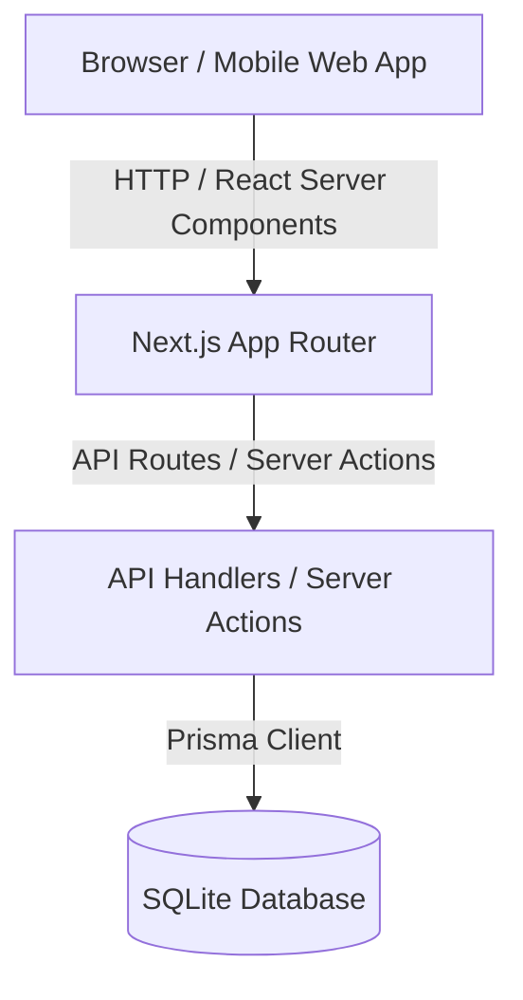

# Architecture Document
## Sistem Informasi Manajemen Alur Stok Linen Hotel
**Studi Kasus:** Hotel Green Star Park Simalungun  
**Teknologi:** Next.js (App Router), TypeScript, Tailwind CSS, shadcn/ui, Prisma, SQLite

---

### 1. High-Level Architecture



---

### 2. Technology Stack Breakdown
- **Frontend Framework:** Next.js 14+ (App Router) dengan TypeScript.
- **Styling & UI Components:** Tailwind CSS, Lucide Icons, shadcn/ui (Button, Card, Dialog, Badge, Input, Table, Tabs, Select, Toast).
- **ORM & Database:** Prisma ORM dengan SQLite (`dev.db`).
- **State & Export Utilities:** React Hooks, XLSX/CSV export utility, CSS `@media print` styling.

---

### 3. Database Schema Design (Prisma)

```prisma
datasource db {
  provider = "sqlite"
  url      = "file:./dev.db"
}

generator client {
  provider = "prisma-client-js"
}

enum Role {
  ADMIN_EXECUTIVE_HOUSEKEEPER
  STAF_HOUSEKEEPING
  STAF_LAUNDRY
}

enum TransactionType {
  DIRTY_TO_LAUNDRY    // Penyerahan linen kotor ke laundry
  CLEAN_TO_HOUSEKEEPING // Penerimaan linen bersih ke gudang housekeeping
  IN_ROOM_DISTRIBUTION // Pemasangan linen di kamar
}

enum LinenCondition {
  GOOD
  STAINED    // Cuci ulang
  DAMAGED    // Afkir / Condemned
}

model User {
  id        String   @id @default(uuid())
  name      String
  email     String   @unique
  role      Role
  createdAt DateTime @default(now())
  updatedAt DateTime @updatedAt
  transactions Transaction[]
  conditionLogs ConditionLog[]
}

model LinenItem {
  id              String   @id @default(uuid())
  name            String   @unique // e.g. Duvet, Sheet, Pillow Case
  unitPrice       Float    // Rp. harga per unit
  totalAsset      Int      // Total unit yang dimiliki hotel
  cleanStock      Int      // Stok bersih di gudang housekeeping
  laundryStock    Int      // Stok sedang dalam proses cuci di laundry
  inRoomStock     Int      // Stok terpasang di kamar hotel
  condemnedStock  Int      // Stok afkir / rusak permanen
  minAlertLevel   Int      // Batas minimum par stock alert
  parStockTarget  Int      // Kuota ideal par stock hotel
  createdAt       DateTime @default(now())
  updatedAt       DateTime @updatedAt
  
  transactions    TransactionItem[]
  conditionLogs   ConditionLog[]
}

model Transaction {
  id              String          @id @default(uuid())
  transactionNo   String          @unique
  type            TransactionType
  notes           String?
  createdById     String
  createdBy       User            @relation(fields: [createdById], references: [id])
  createdAt       DateTime        @default(now())
  
  items           TransactionItem[]
}

model TransactionItem {
  id            String      @id @default(uuid())
  transactionId String
  transaction   Transaction @relation(fields: [transactionId], references: [id], onDelete: Cascade)
  linenItemId   String
  linenItem     LinenItem   @relation(fields: [linenItemId], references: [id])
  quantity      Int
}

model ConditionLog {
  id            String         @id @default(uuid())
  linenItemId   String
  linenItem     LinenItem      @relation(fields: [linenItemId], references: [id])
  condition     LinenCondition
  quantity      Int
  notes         String?
  reportedById  String
  reportedBy    User           @relation(fields: [reportedById], references: [id])
  createdAt     DateTime       @default(now())
}

model DailyOccupancy {
  id            String   @id @default(uuid())
  date          DateTime @default(now())
  occupiedRooms Int
  totalRooms    Int      @default(100)
  notes         String?
  createdAt     DateTime @default(now())
}
```

---

### 4. Business Logic Flow & State Mutations

1. **Penyerahan Linen Kotor (Housekeeping -> Laundry):**
   - Transaksi `DIRTY_TO_LAUNDRY`.
   - Mutasi Stok: `inRoomStock` atau `cleanStock` berkurang, `laundryStock` bertambah sebanyak `quantity`.
2. **Penerimaan Linen Bersih (Laundry -> Housekeeping Gudang):**
   - Transaksi `CLEAN_TO_HOUSEKEEPING`.
   - Mutasi Stok: `laundryStock` berkurang, `cleanStock` bertambah sebanyak `quantity`.
3. **Pencatatan Condition Log:**
   - Jika `GOOD`: Tidak mengubah distribusi stok.
   - Jika `STAINED`: Menandai item untuk diproses *rewash* (tetap di `laundryStock`).
   - Jika `DAMAGED` (Afkir): Sistem OTOMATIS memotong persediaan aktif (`cleanStock` atau `laundryStock`) sebanyak `quantity`, memotong `totalAsset` sebanyak `quantity`, dan menambahkan `condemnedStock` sebanyak `quantity`.
4. **Kalkulasi Par Stock Health & Procurement:**
   - Active Stock = `cleanStock` + `laundryStock` + `inRoomStock`.
   - Deficit = `parStockTarget` - Active Stock.
   - Estimated Budget = `Deficit * unitPrice`.

---

### 5. UI/UX Component Architecture
- `app/layout.tsx`: Navigation sidebar, header dengan fast role switcher & hotel branding.
- `app/page.tsx`: Dashboard Utama (KPI summary cards, Par Stock Health indicators, Daily Occupancy Widget).
- `app/transactions/page.tsx`: Modul Transaksi Masuk-Keluar Harian (+ Quick numeric buttons: +1, +5, +10, -5).
- `app/condition/page.tsx`: Modul Pencatatan Status & Kondisi Linen (Good, Stained, Damaged auto-afkir).
- `app/procurement/page.tsx`: Modul Rekomendasi Pengadaan Unit Baru (Deficit breakdown & Budget calculator).
- `app/reports/page.tsx`: Modul Laporan Bulanan (Circulation table, Deficit loss table, CSV export, Print layout).
